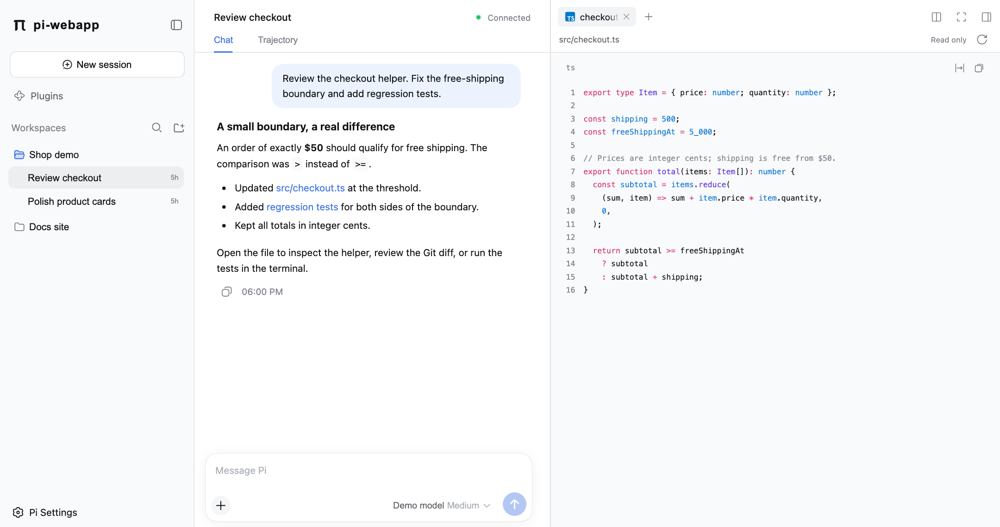
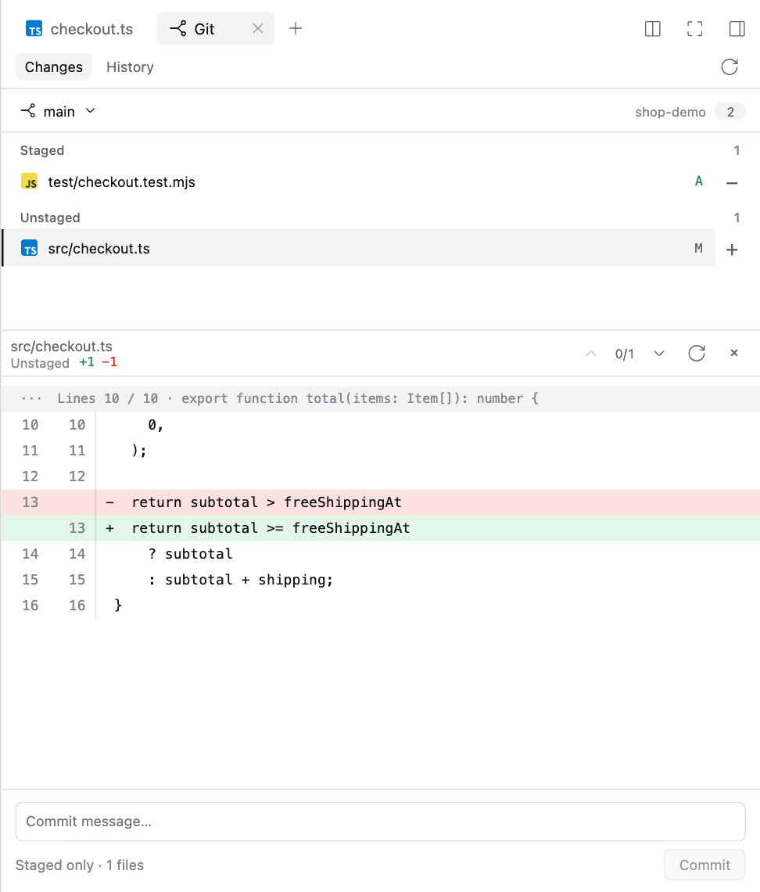
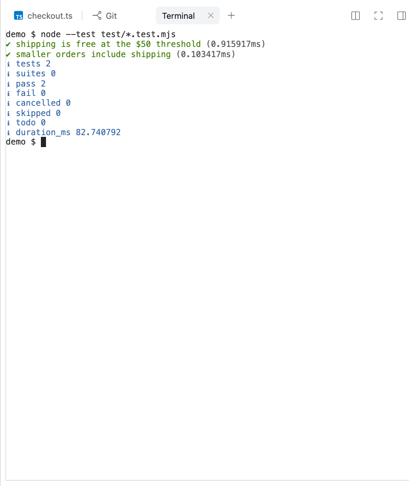
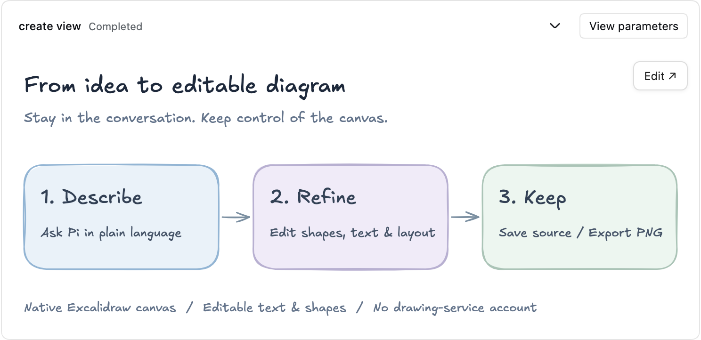
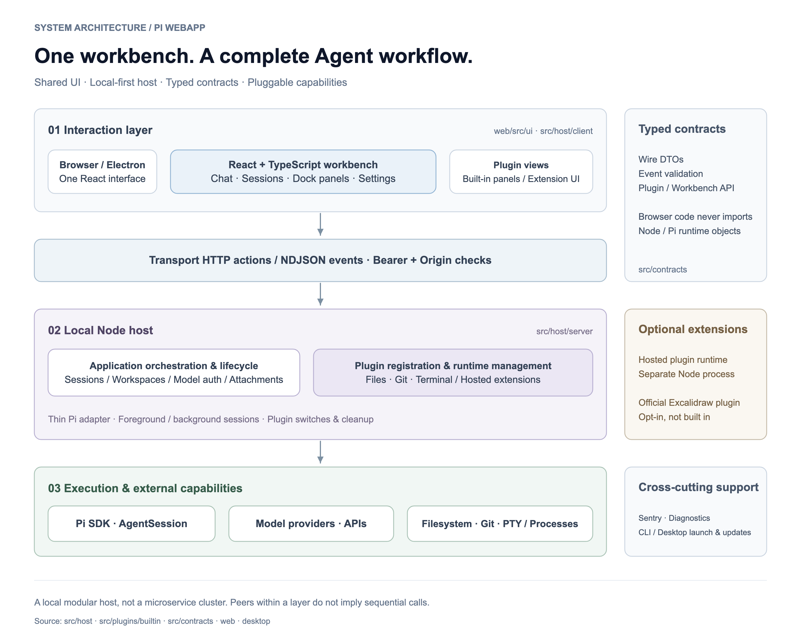

# pi-webapp

### One workspace for your Pi coding agent.

Conversations, project files, terminals, and Git—side by side. Use the same workbench in your browser or on desktop, while keeping Pi's tools, skills, extensions, and terminal workflow.

[简体中文](README.zh-CN.md) · [Get started](#get-started) · [Download desktop](#desktop-downloads) · [Architecture](#architecture-highlights) · [User guide](docs/en/getting-started.md) · [npm](https://www.npmjs.com/package/pi-webapp)

**Desktop test build 10:** macOS (Apple Silicon / Intel), Windows x64, and Linux x64. [Downloads, checksums & safe installation](#desktop-downloads). These are unsigned/unnotarized test packages, not stable releases.

[](assets/readme/workbench.png)

*Follow the conversation and inspect the linked source file in the same workspace. Real UI, seeded demo data—not a live model transcript.*

```bash
npx pi-webapp
```

**One command for the Web. A bundled runtime for desktop. The same Pi underneath.**

## Why pi-webapp?

- **Keep your coding context together.** Follow the agent, inspect a file, run a command, and review a diff without leaving the workspace.
- **Work across projects without interrupting tasks.** Chats run independently; switching projects or starting another conversation leaves existing work running in the background.
- **See what the agent is doing.** Streaming replies, expandable reasoning and tool calls, token usage, and execution traces make progress easier to follow.
- **Build on Pi, not around it.** Keep Pi's session storage, model choices, skills, and extension ecosystem. The interface adds a workbench, not a replacement agent engine.

## See the workflow

**Discuss → inspect → review → verify.** The workbench above keeps your conversation and source side by side; the same tool panel takes you from reviewing a change to running its tests.

| Review before committing | Verify in a real terminal |
| --- | --- |
| [](assets/readme/git-review.png) | [](assets/readme/terminal.png) |
| Inspect the diff and stage only what you intend to commit. | Run project commands without losing the conversation. |

*Click any image for full size. Screenshots use an isolated demo repository. The terminal really runs its two regression tests; no provider credentials or private project data are used. [How these images are made](assets/readme/README.md).*

## Excalidraw: turn conversations into editable diagrams

**Describe it → refine it → keep it.** Ask Pi for an architecture diagram, flowchart, or concept sketch. The drawing appears in the conversation; **Edit** opens the native Excalidraw canvas—not a flattened image.

[](assets/readme/excalidraw.png)

*Real plugin UI with a seeded example, not a live model transcript. Click the image for full size.*

- **Create in context:** describe the drawing in the main conversation, without opening another drawing service.
- **Make it yours:** move shapes, edit labels, adjust layout, and use native undo/redo.
- **Keep the result:** save editable `.excalidraw` source to the workspace or export a PNG from the editor.

**Optional plugin:** explicitly install and enable `@chengzhiyi/pi-excalidraw` in **Plugins → Hosted plugins**, using an available compatible release. It is not bundled or auto-installed, and needs no drawing-service account. [Setup, saving & recovery](docs/diagrams.md).

## Core features

| Capability | What you can do |
| --- | --- |
| **Live agent conversations** | Send messages and image/file attachments; pause and continue tasks; switch models and thinking levels. Render Markdown, code, reasoning, and tool results in context. |
| **Multi-project sessions** | Discover saved Pi sessions, add workspaces, and switch between independently running chats. Return to ongoing output and pending plugin interactions. |
| **Files beside the conversation** | Browse the workspace, follow file links from chat, and preview highlighted code, Markdown, and images in read-only tabs. |
| **Real integrated terminals** | Run interactive shells in the workspace, use Ctrl+C, and keep processes and output when switching chats or panels. |
| **Git review and workflow** | Review changes and inline diffs, stage/unstage files, commit the staged index, create/switch local branches, and explore commit history with a branch graph. |
| **A flexible workbench** | Resize, split, or expand tool panels; use workspace focus mode while keeping navigation within reach. Each chat retains its own tool tabs until the page reloads. |
| **Models, skills, and plugins** | Configure providers and models, manage Pi packages/extensions/skills, and toggle bundled Files, Terminal, and Git capabilities. Supported Web plugins can add their own UI. |
| **Browser and desktop entry points** | Use the background launcher, open `/web` from Pi's terminal, or launch the Electron desktop app with bundled Node/Pi. |

> Chats run independently, but files and Git changes in the same worktree are shared. Switching chats does not stop work; stopping the service ends its background tasks. Terminals and agent tools run with your system permissions, not in a sandbox.

## Get started

### Web: run one command

Requires **Node.js 22.19+** and npm. Run in your project directory:

```bash
npx pi-webapp
```

The launcher starts a local background service with the package's pinned **Pi SDK 1.3.0** and opens your browser. No global Pi installation is needed or changed. Run the command again to reopen the existing service.

On headless machines, it prints the local address. Set `PI_WEBAPP_AUTO_OPEN=0` to disable automatic browser opening.

1. Open **Settings → Models** to configure a provider and choose a model you have access to.
2. Select or add a workspace, then start a conversation.
3. Open the conversation's upper-right tool panel to explore **Files**, **Terminal**, or **Git changes** alongside the agent.

Model access is required separately; a local interface does not mean offline inference. Keep token-bearing local URLs private and do not expose the service directly to the public internet.

```bash
npx pi-webapp status   # Show the running service address
npx pi-webapp stop     # Stop the service after active work finishes
```

Prefer a global command? Run `npm install -g pi-webapp`, then `pi-webapp`.

**Updates:** npm-launcher installations support **Settings → General → App updates → Update and restart**, with rollback if the new service fails to start. Finish active work first. Source checkouts and terminal `/web` sessions show version information but cannot restart from the page. See the [update guide](docs/en/updates.md).

### Already using Pi in a terminal?

```bash
pi install npm:pi-webapp
pi
```

Enter **`/web`** inside Pi. The browser stays synchronized with that terminal session; Pi continues to own the agent, tools, and session storage. Exiting that Pi process ends its service.

## Desktop downloads

**Latest desktop test release: [pi 0.1.28 · build 10](https://github.com/chengzhiyi/pi-webapp/releases/tag/desktop-v0.1.28-b10).** Download the installer for your operating system and CPU:

| Platform | Download |
| --- | --- |
| **macOS · Apple Silicon (arm64)** | [Download DMG](https://github.com/chengzhiyi/pi-webapp/releases/download/desktop-v0.1.28-b10/pi-0.1.28-desktop.10-mac-arm64.dmg) |
| **macOS · Intel (x64)** | [Download DMG](https://github.com/chengzhiyi/pi-webapp/releases/download/desktop-v0.1.28-b10/pi-0.1.28-desktop.10-mac-x64.dmg) |
| **Windows · x64** | [Download EXE installer](https://github.com/chengzhiyi/pi-webapp/releases/download/desktop-v0.1.28-b10/pi-0.1.28-desktop.10-win-x64.exe) |
| **Linux · x64** | [Download AppImage](https://github.com/chengzhiyi/pi-webapp/releases/download/desktop-v0.1.28-b10/pi-0.1.28-desktop.10-linux-x86_64.AppImage) |

[All releases](https://github.com/chengzhiyi/pi-webapp/releases) · [SHA256SUMS](https://github.com/chengzhiyi/pi-webapp/releases/download/desktop-v0.1.28-b10/SHA256SUMS) · [Build/runtime metadata](https://github.com/chengzhiyi/pi-webapp/releases/download/desktop-v0.1.28-b10/desktop-release.json)

**Build 10 separates shell and business-package updates.** It can safely attach to existing npm 0.1.26/0.1.27 services without stopping their tasks. Install this shell once, then use **Settings → App updates** for compatible `pi-webapp` package updates in your user directory. Finish chats and close terminals before restarting the backend.

The **pi** desktop app bundles Node and Pi—no separate runtime installation needed. It can reuse a compatible Web service, open the same service in your browser, and let you choose whether background tasks continue after closing the app. Bring your own model credentials, Git/SSH setup, and project toolchains.

- **Install:** macOS: drag **pi.app** from the DMG into Applications. Windows: run the EXE installer. Linux: make the AppImage executable and run it; see the release notes for the FUSE alternative.
- **Verify:** compare the installer with `SHA256SUMS` from the same release. Confirm **build 10** in **pi → 关于 pi (About pi)**. Quit the old desktop before replacing it; do not delete `~/.pi`.
- **Test-release limits:** these are opt-in prereleases, not publisher-signed stable distributions. macOS uses ad-hoc signatures without Apple notarization and may be blocked by Gatekeeper; follow the [macOS test installation guide](docs/desktop-testing.md) and stop if verification fails. Windows/Linux packages are unsigned. Never disable system security globally. Desktop shell updates require manual installation; business-package updates use the app's Settings. Windows ARM and Linux ARM are not included.

## Architecture highlights

**Shared React workbench → local Node host → Pi execution.** This is a local, modular application—not a microservice cluster. Pi owns agent execution and session persistence; pi-webapp adds the interface, session orchestration, and workspace capabilities.

[](assets/readme/architecture-en.png)

*Three main connectors show the layer boundaries. Components within a layer are peers, not a sequential call chain. Click to view full size.*

| Design choice | Why it matters |
| --- | --- |
| **Thin Pi adapter, separate host** | Agent integration stays small; server orchestration, browser UI, and workspace capabilities have explicit ownership instead of growing inside one extension entry point. |
| **Typed, validated cross-boundary contracts** | Browser code uses wire DTOs rather than Node/Pi runtime objects. HTTP actions and NDJSON events keep commands and live state updates explicit. |
| **Plugin-owned capabilities** | Built-in Git, Files, and Terminal each own their server/client/contracts and cleanup. A registry dispatches requests; the host workbench manages tabs, docking, focus, and session identity. |
| **Lifecycle-aware sessions** | Background sessions retain progress and pending interactions when you navigate away. Switching a chat preserves tool resources; closing a tab disposes its resource. |
| **Guardrails at the host boundary** | Loopback transport uses token/origin checks; file previews enforce workspace and symlink boundaries. Git writes reject stale state and coordinate known chats sharing the worktree. These checks are not an OS sandbox. |
| **One UI across entry points** | React + TypeScript power the workbench, Vite/esbuild bundle the app, and Electron provides the desktop shell without a separate conversation UI. |

**Optional, not built in:** drawings belong to the official `@chengzhiyi/pi-excalidraw` plugin, installed and enabled explicitly in Plugins. The host ships no editor/fonts and does not auto-install it on offline startup. Hosted plugins use a separate Node process for lifecycle management—not a security sandbox. Development protocol/plugin artifacts on this branch are verification-only, not a published release. See [drawing migration and recovery](docs/diagrams.md) for update behavior and preserved backups.

### Source map

| Directory | Responsibility |
| --- | --- |
| `web/src/ui/` · `src/host/client/` | Shared UI, conversation shell, workbench, and browser plugin management |
| `src/host/server/` | Transport, sessions, workspaces, model configuration, and plugin lifecycle |
| `src/adapters/pi/` | Thin Pi extension entry point |
| `src/plugins/builtin/` | Files, Git, and Terminal; each owns server, client, and contracts |
| `src/contracts/` · `src/platform/telemetry/` | Wire contracts and shared diagnostics |
| `bin/` · `desktop/` | CLI launcher and Electron shell |

Read the [architecture and ownership guide](docs/architecture.md) or [Web plugin integration notes](docs/web-plugins.md) for lifecycle and extension details.

## Guides & development

- **New users:** [First conversation](docs/en/getting-started.md) · [Sessions](docs/en/sessions.md) · [Workspace tools](docs/en/workspace-tools.md)
- **Configuration:** [Models, packages, and skills](docs/en/configuration.md) · [Updates](docs/en/updates.md) · [Troubleshooting](docs/en/troubleshooting.md)
- **Contributors:** [Architecture](docs/architecture.md) · [Web plugins](docs/web-plugins.md) · [Desktop builds](docs/desktop.md)

The guides follow the source tree; installed versions may differ. For desktop availability, use the verified release links above and their release notes.

### Develop locally

```bash
npm ci
npm run check
npm test
npm run start   # Build and launch the local service
```

`npm run start` builds and launches the background service. After changing extension code, run `npm run stop` and `npm run start`; reloading the browser alone does not replace the bridge. With `pi -e .`, rebuild and enter `/reload`, then `/web` in Pi.

For desktop development: `npm run desktop:prepare` → `npm run desktop:start`. `npm run desktop:package` creates a host-native installer in `desktop-release/`. For trusted local plugin development, see `PI_WEBAPP_PLUGIN_DEV_ROOTS` in the [plugin notes](docs/web-plugins.md).

---

[Report a bug or request a feature](https://github.com/chengzhiyi/pi-webapp/issues) · [Star on GitHub](https://github.com/chengzhiyi/pi-webapp)

MIT licensed. See [LICENSE](LICENSE).
