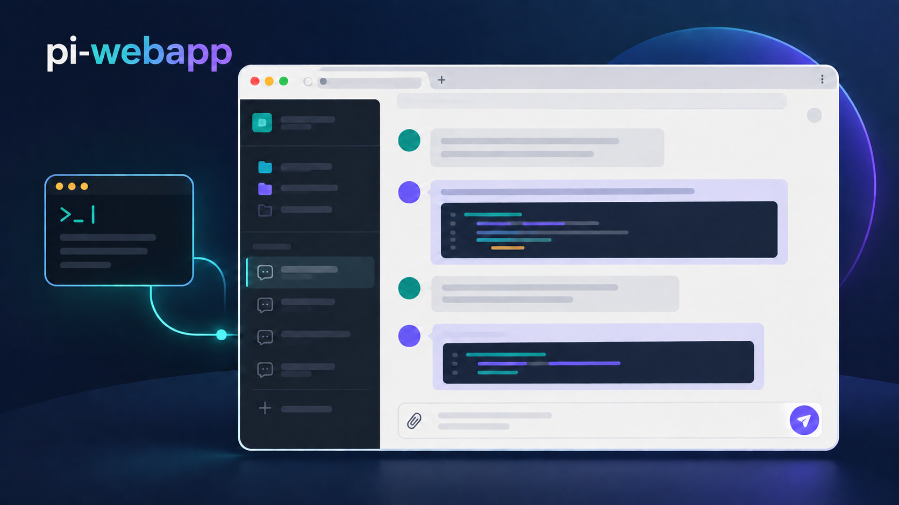

# pi-webapp

[简体中文](README.zh-CN.md)



**pi-webapp** opens the active Pi coding agent session in a local browser. Pi continues to run the agent, tools, and session storage; the browser provides a live interface for conversation and control.

## Install and open

Requires Node.js 22.19 or later. To open the web interface directly:

```bash
npx pi-webapp
```

This starts Pi in the background and opens the default browser on a local graphical desktop, leaving the terminal free. If Pi is missing, the launcher installs the official `@earendil-works/pi-coding-agent` package with npm. An existing Pi installation must be version 0.87.1 or later. The launcher does not replace an older installation automatically. Running the launcher again reopens the existing server. Remote or headless sessions print the address instead; set `PI_WEBAPP_AUTO_OPEN=0` to disable automatic opening.

In Settings → General → App updates, the web page checks npm for a newer `pi-webapp` release. When started by the background launcher from an npm package, **Update and restart** installs the verified release under Pi's `pi-web/releases/` data directory, restarts the server, and reloads the same browser address. Wait for any active reply to finish first. If the new version cannot start, the launcher restores the previous service. This works for both `npx` and global-command launches; later launches select the managed release automatically. It does not change the npm global installation. Source checkouts and `/web` pages opened from an existing Pi terminal show version information but cannot restart from the web page. If the service does not return, run `pi-webapp status` and check `~/.pi/agent/pi-web/launcher.log`.

Use `npx pi-webapp status` to show the address and `npx pi-webapp stop` to stop the background service. After a global install, use `pi-webapp status` and `pi-webapp stop`.

You can also install the launcher globally:

```bash
npm install -g pi-webapp
pi-webapp
```

To use the extension inside an existing Pi terminal, the original workflow remains available:

```bash
pi install npm:pi-webapp
pi
```

In Pi, enter `/web` to open the interface in your default browser. Pi also prints the local URL for remote or headless environments. The URL contains a random token valid only for the current Pi process. Enter `/web` again to reopen it.

## Features

- View the current conversation with Markdown, streaming output, expandable reasoning and tool calls, token usage, and a turn-by-turn trace.
- Send messages, pause and continue a run, start a new Pi session, and change the current model or thinking level. The bottom-right control pauses an active run; an empty composer offers Continue after pausing, including after refreshing or reopening the session. Continue uses an internal control action without adding a user message; the model makes a new request based on existing progress, and plan mode still requires fresh approval.
- Browse workspaces and saved sessions. Add a workspace with the native directory picker when available, or use the built-in directory browser over SSH.
- Open the right sidebar from the permanent control in the conversation’s upper-right corner. Choose **Workspace files** to browse the current session’s directory tree and open read-only file tabs. Workspace-relative and in-workspace absolute file links in the conversation also open these previews; external URLs still open in a new tab. Previews support highlighted code with line numbers, Markdown with preview/source modes, and PNG/JPEG/GIF/WebP images with a lightbox. The sidebar supports resizing, split panes, fullscreen, and plugin content. Switching chats retains their tabs and expanded directories until the page reloads. Manually reload listings or previews as needed. Listings show up to 1,000 entries per directory; text previews allow up to 512 KB / 10,000 lines, and images up to 8 MB. HTML/SVG remain source text; unsupported binary files show a notice. Reads, including resolved symlink targets, stay within the current session’s workspace.
- Choose **Open terminal** on the right sidebar’s start page to launch the default shell in the current session’s workspace. Supports interactive input, streaming output, Ctrl+C, resizing, split panes, and fullscreen. Tab changes, sidebar collapse, and chat switches retain the process, environment, and screen. Short disconnects reconnect automatically without replaying uncertain input. Closing a tab or stopping the service reaps its process; disconnected browsers have a five-minute retention window. Page reloads reset tabs, and processes do not survive service restarts. Limits: 8 terminals per session, 32 per service, and 2,000 scrollback rows. Shells run with the Pi user’s system permissions; the workspace is their initial directory, not a shell sandbox.
- Choose **Git changes** on the right sidebar’s start page to review the current branch, commit, locally recorded upstream divergence, and staged, unstaged, untracked, or conflicted files. Click a file to preview its read-only unified diff inside the Git panel, keeping the file list visible and the tab count unchanged. Lists and diffs scroll independently; narrow panes stack them and panes at least 720 px wide place them side by side. The selected file is highlighted and retained with its Git tab, follows staging changes, and clears when the file is no longer changed. Close the preview to restore the full list. Diffs hide raw Git headers, show old/new line numbers and addition/deletion counts, and offer previous/next navigation between contiguous change blocks with a position counter. File-mode changes and missing final newlines retain compact notices. Reads stay within the session’s directory, including when it is a repository subdirectory; linked worktrees and repositories without commits are supported. Visible Git tabs refresh after agent state changes, on focus, and every five seconds; hidden tabs stop polling. Requires Git on the machine running Pi. Lists show up to 1,000 files and diffs up to 512 KB / 10,000 lines. Binary files, submodules and unresolved conflicts show notices. Changes belong to the shared working tree, not exclusively to one chat; working-file and historical diffs remain read-only.
- In **Git changes → Changes**, use each file’s **+ / −** button to stage or unstage it, use the fixed bottom composer to commit only the staged index (Ctrl/Cmd+Enter is supported), and click the branch name to search/switch local branches or open **New branch**. The file list scrolls independently; full repository metadata is available on the short repository name’s tooltip. Drafts stay with each chat’s Git tab. Commits and branch switches require a root workspace; switching also requires a clean working tree, including untracked files. Writes require all known chats using the worktree to be idle, reject stale snapshots, and honor Git hooks/signing. Conflicts, active Git operations, locks and occupied worktree branches block incompatible writes. Failed or unconfirmed operations retain drafts and never retry automatically. Changes are shared by chats using the same worktree. No fetch/push, forced switch, stash or discard is performed.
- In **Git changes → History**, browse commits alongside their branch/merge graph, with HEAD, local branch, remote-tracking branch and tag labels. Load history 50 commits at a time; a ref change resets pagination to prevent mixed histories. Open commit details for the full message, author/committer, timestamps, parents and changed files, then preview a read-only file diff alongside the same commit file list without opening another tab. Merge details let you select the parent to compare against; root commits compare against an empty tree. The graph shows repository-wide metadata while commit files and diffs stay within the session directory. Graph selection and loaded history remain with each chat’s Git tab until the page reloads. Remote labels use local refs without fetching.
- Attach up to 20 files of 20 MB each by selecting, dropping, or pasting them. Images show previews and are also sent as Pi image content.
- Open Plugins directly below New session in the sidebar to inspect and switch the bundled Git, Files and Terminal capabilities. Switches are global, persist locally, and require every chat to be idle. Disabling closes related tabs and blocks backend requests; Terminal asks for confirmation before ending all service-owned terminals. External Pi Web runtimes remain managed through Packages & extensions rather than a misleading UI-only switch.
- Manage appearance, Pi packages, extensions, skills, and models from the settings panel. The Models page can add models, edit display names, context windows, output limits, and input types, and restore built-in defaults; changes are saved to Pi's `models.json`. Browser sign-in opens the provider's authorization page automatically; manual code entry remains available when a callback cannot reach Pi. Stored provider credentials can also be removed there. Credentials stay in Pi's local `auth.json` and are never returned to the browser.

If you enter `/web` manually in a Pi terminal, that terminal session stays synchronized with the browser. With the launcher, Pi runs in the background. Sessions opened in other workspaces use the Pi SDK and load that workspace's skills and project context. They load enabled Web plugin Pi entries explicitly while keeping other Pi extensions isolated from the parent bridge.

Chats run independently: switching workspaces or chats, or creating a new chat, leaves existing tasks running in the background. Returning to a chat restores its running output, history, and pending plugin interactions. Stop affects only the selected chat. Sessions remain in memory until the Pi service stops; stopping or restarting the service ends background tasks.

On startup, the app discovers workspaces from Pi's saved sessions, so conversations from other directories appear in the sidebar. Workspace records and attachments stay under Pi's existing `pi-web/` data directory. Removing a workspace from the sidebar does not delete its files or sessions; you can add it again manually.

## Optional desktop application

**[Download pi desktop test releases](https://github.com/chengzhiyi/pi-webapp/releases)** — macOS Apple Silicon (arm64) only for now. Download the DMG from a `desktop-v...` prerelease; compare `SHA256SUMS`, install **pi.app**, and check the build in **pi → 关于 pi**. These builds are unsigned/unnotarized; do not globally disable macOS security. Windows/Linux are not yet validated release downloads.

The same UI can run in the **pi** Electron desktop application while the browser and `/web` entry points remain available. Desktop packages include Node/Pi, reuse compatible running services, and let you open the same service in a browser or choose whether to keep background tasks running on exit.

From source: `npm ci` → `npm run desktop:prepare` → `npm run desktop:start`. Run `npm run desktop:package` to create a host-native installer under `desktop-release/`. Local QA targets macOS arm64; Windows/Linux configurations need verification on their respective systems. Initial packages are unsigned and do not auto-update. Installers include a desktop build number; check **pi → 关于 pi** for the running build and executable location. Quit the old desktop before replacing it; an external compatible Web backend need not be stopped. Finish tasks and stop an owned runtime before replacing that runtime.

See [desktop build, testing and release boundaries](docs/desktop.md).

## Develop locally

```bash
npm install
npm run check
npm run test
npm run build
npm run start
npm run status
npm run stop
```

`npm run start` builds the project, starts Pi in the background, and opens the web interface. After editing the extension, run `npm run stop` followed by `npm run start`. If you develop with `pi -e .`, enter `/reload` and `/web` in Pi after rebuilding. Refreshing an old browser page alone does not replace the running bridge.

For local Web plugin development with the sibling `pi-extensions` workspace, follow its `README.md`. Set `PI_WEBAPP_PLUGIN_DEV_ROOTS=../pi-extensions/packages/plan-mode` when starting this app; browser asset changes refresh automatically and Pi entry changes trigger a safe reload when the agent is idle.

Source ownership is split across `src/adapters/pi/` (the thin Pi entry), `src/host/` (server and browser host), `src/plugins/builtin/` (Git, Files and Terminal, each with server/client/contracts), `src/contracts/`, and shared UI in `web/src/ui/`. See [architecture and plugin management](docs/architecture.md). The npm package contains only the bundled, minified JavaScript extension, built web assets, cover image, and the English and Chinese READMEs. No TypeScript source or source maps are published. Minification makes the shipped code harder to read; it does not encrypt JavaScript.

## Error collection

Frontend and extension Sentry error reporting is enabled by default with the built-in public DSN. Set `PI_WEB_SENTRY_DSN` in the Pi process environment to use another project, or `PI_WEB_SENTRY_ENABLED=false` to disable reporting. Collection is limited to sanitized stacks, semantic breadcrumbs and state summaries; conversations, source contents, attachments, credentials and session recordings are excluded. See [Sentry configuration](docs/sentry.md) for the default destination, separate destinations, limits and private source-map uploads.

## Publish

CI resolves the published `@chengzhiyi/pi-web-protocol` version before `npm ci`.
Until the first protocol publication, verification builds a pinned `pi-extensions`
commit in an ignored `.ci/` checkout and uses that local package. Checks, tests,
and builds still run; the Actions summary explains why host publication is waiting.
Release builds always require the published npm dependency. Once it exists, the
next workflow uses its exact version and the release commit records the lockfile.
Use Actions' manual run after initializing npm; protocol releases do not trigger
this repository automatically.

`npm publish` runs the checks, tests, and production build. The `pi-package` keyword makes the published npm package eligible for the [Pi package catalog](https://pi.dev/packages); catalog updates may lag behind npm.

GitHub Actions runs `check`, `test`, and `build` on pull requests to `main`. A push to `main` repeats those checks, chooses the next patch version from the source version and npm `latest`, then commits the updated `package.json` and `package-lock.json` to `main` before publishing. The release commit uses the workflow's `GITHUB_TOKEN` and does not start another workflow run. To start a new minor or major series, raise the version in both package files in the pull request. Each release also updates the package's `pi.image` URL to its own version. The repository must allow the workflow to push to `main` for publishing to proceed.

Before the first automated release, configure npm Trusted Publishing for the `pi-webapp` package: GitHub owner `chengzhiyi`, repository `pi-webapp`, workflow filename `ci.yml`, no environment, and allow direct `npm publish`. This workflow uses GitHub's OIDC identity and does not need an npm token. Keep the package's repository URL in `package.json` aligned with the GitHub repository.

## License

MIT. See the `LICENSE` file.
